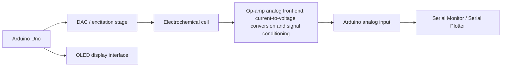

# Design-a-Low-Power-Potentiostatic-Readout-Circuit-for-a-3-Electrode-Electrochemical-System
An Arduino-controlled electrochemical setup for cholesterol sensing. The work combines op-amp signal-conditioning circuits, a DAC-based excitation stage, embedded data acquisition, PCB design, and a 3D-printed enclosure for a compact prototype.

> **Project status:** Prototype / preliminary testing. The observations described here are early experimental results, not a calibrated or clinically validated cholesterol measurement system.

## What the project is trying to do

Electrochemical sensors can produce small currents that are difficult to measure directly. This project looks at the complete measurement chain: applying a controlled potential to an electrode setup, converting the resulting current into a measurable voltage, and reading the signal with a microcontroller.

Alongside the circuit and firmware work, a two-sided PCB and 3D-printed parts were developed with the goal of making the setup more compact and easier to handle.

## System overview



The diagram shows the intended high-level signal path. Exact wiring, component part numbers, and pin assignments should be documented with the circuit and firmware files before reproducing the setup.

## Main parts of the work

### 1. Analog front end

- Designed and simulated an op-amp voltage-follower circuit with an adjustable reference/output arrangement.
- Worked on a current-to-voltage converter to make the sensor current readable as a voltage.
- Combined and revised circuit stages through simulation before moving to breadboard testing.
- Tested signal-conditioning behaviour with generated pulses and small input signals in simulation.

### 2. Arduino and signal generation

- Developed the microcontroller-side approach for reading an analog voltage and working with its digital value.
- Explored DAC operation and pulse generation for the electrochemical setup.
- Worked on displaying readings and observing output through the Arduino Serial Monitor / Serial Plotter.
- Included an OLED display connection in the interface and PCB design.

### 3. PCB design

- Designed a two-sided Arduino Uno shield and a PCB for the wider sensing circuit.
- Created or adjusted footprints where suitable component footprints or 3D models were unavailable, including parts for the DAC and OLED interface.
- Worked on schematic capture, component placement, routing, and 2D/3D board views.

### 4. Mechanical design

- Created 3D models for the sensor setup and an Arduino enclosure.
- Printed enclosure and fixture variations to check fit and handling.
- Used the mechanical design work to move towards a more compact, portable prototype.

## Preliminary experiment

The first raw test documented in the project used the following setup:

| Item | Setup used in the initial test |
| --- | --- |
| Working electrode (WE) | NiZnOCuO hybrid nanomaterial, 1:1 ratio |
| Reference electrode (RE) | Ag/AgCl |
| Counter electrode (CE) | Platinum wire |
| Test medium | Aqueous PBS with 10 mM cholesterol |
| Applied pulse | Reported as 520 mV for 30 seconds across the working and counter electrodes |

A transient spike was observed near the end of the voltage pulse in this initial run. It was noted as a possible response worth investigating, but **one observation is not enough to confirm cholesterol detection**. Repeated measurements, blank samples, concentration-dependent tests, and appropriate controls are needed before drawing a conclusion.

The values above describe the test recorded during development; they should not be treated as a validated protocol or a medical measurement method.

## Current progress

- [x] Simulated the main op-amp and current-to-voltage circuit stages
- [x] Combined circuit stages and reviewed the signal path in simulation
- [x] Explored Arduino analog input, pulse generation, and DAC operation
- [x] Prepared schematic, routing, and 2D/3D views for the PCB
- [x] Designed and printed enclosure / sensor-fixture parts
- [x] Performed an initial breadboard test and recorded a preliminary response
- [ ] Add the standalone Arduino firmware and document the exact pin mapping
- [ ] Publish the editable circuit-simulation and PCB design files
- [ ] Repeat tests with blanks and multiple cholesterol concentrations
- [ ] Characterize repeatability, calibration, and possible interference from other substances

## Suggested repository layout

Keep editable project files separate from screenshots and presentation material. A useful layout is:

```text
.
├── README.md
├── firmware/
│   ├── *.ino
│   └── README.md                 # board, libraries, pin map, and settings
├── simulation/
│   ├── schematics/               # editable circuit files
│   └── results/                  # selected waveforms/screenshots
├── hardware/
│   ├── schematics/               # PDF + original editable files
│   ├── pcb/                      # native PCB project and fabrication exports
│   └── 3d-models/                 # editable CAD files and STL exports
├── docs/
│   ├── images/                   # compressed diagrams and prototype photos
│   ├── experiment-notes.md
│   └── report.pdf
└── .gitignore
```

Only include folders and files that actually exist in the repository. Keep the original editable files wherever possible; screenshots alone are not enough for someone to modify or reproduce the design.

## Reproducing the setup

Before attempting to recreate the hardware, add these details alongside the source files:

1. Exact op-amp, DAC, display, resistor, and other component part numbers.
2. A readable schematic and the PCB source project, not only rendered images.
3. Arduino pin mapping, DAC output scaling, pulse settings, and any required libraries.
4. Electrode connections and the procedure used for preparing and measuring samples.
5. Raw observations from repeated tests, including blank/control measurements.

Check the signal-conditioning stages with known electrical inputs before connecting the sensor cell. The current prototype is for project and research use only; it is not a medical or diagnostic device.

## Limitations and next steps

The biggest open question is whether the observed signal is repeatable and specific to cholesterol. The next useful steps are to repeat the experiment, include PBS-only blank measurements, test multiple known concentrations, and document how the measured signal changes. Calibration and interference testing would be needed before making quantitative claims.

The hardware documentation also needs to include the final component values, module models, pin map, and editable design files so that another person can build the same setup.
